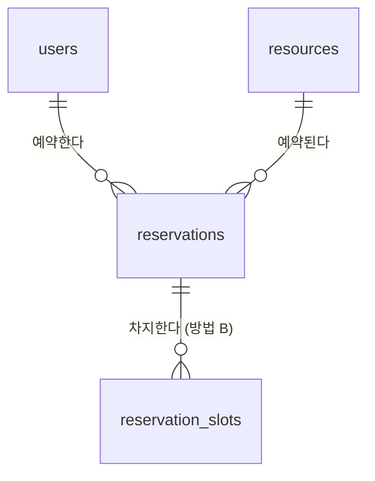

# Reservation API

회의실 같은 공용 자원의 예약을 관리하는 REST API입니다.
같은 시간대에 예약이 겹치지 않도록 하는 **동시성 제어**를 핵심 과제로 다룹니다.

> 🚧 개발 중입니다. 현재는 회원가입·로그인, 자원(회의실) 관리, 예약 생성·조회·취소 API까지 구현되어 있습니다.

- 배포 주소: (배포 후 추가)
- API 문서: 서버 실행 후 `/docs` (Swagger UI)

## 기술 스택

| 구분 | 사용 기술 |
| --- | --- |
| 언어 / 프레임워크 | Python 3.11, FastAPI |
| DB / ORM | MySQL 8.0, SQLAlchemy 2.x, PyMySQL |
| 테스트 / 품질 | pytest, ruff, GitHub Actions |

## 주요 기능 (계획)

- [x] 회원가입과 로그인 (JWT, Argon2id 비밀번호 해시)
- [x] 자원(회의실) 등록, 조회, 수정, 비활성화 (등록과 수정은 관리자만)
- [x] 예약 생성, 조회, 취소
- [x] 같은 시간대 중복 예약 방지 (동시 요청 상황 포함, 비관적 락)
- [x] 다른 방식(시간 칸 + 기본키)으로 구현해 같은 테스트로 검증
- [ ] 두 방식의 부하 테스트 (처리량, 응답 시간, 데드락)
- [ ] 배포

## API

| 메서드 | 경로 | 설명 |
| --- | --- | --- |
| GET | `/health` | 서버 상태 |
| GET | `/health/db` | DB 연결 상태 (실패 시 503) |
| POST | `/auth/signup` | 회원가입 (이메일 중복 시 409) |
| POST | `/auth/login` | 로그인, 액세스 토큰 발급 (OAuth2 form: `username`에 이메일) |
| GET | `/users/me` | 내 정보 🔒 |
| POST | `/resources` | 자원 등록 (이름 중복 시 409) 🔒 관리자 |
| GET | `/resources` | 자원 목록 (`include_inactive`, `limit`, `offset`) |
| GET | `/resources/{id}` | 자원 상세 |
| PATCH | `/resources/{id}` | 자원 수정, `is_active: false`로 비활성화 🔒 관리자 |
| GET | `/resources/{id}/reservations?date=YYYY-MM-DD` | 자원의 하루 일정 (예약된 시간대만, 예약자는 비공개) |
| POST | `/reservations` | 예약 생성 (시간이 겹치거나 비활성 자원이면 409) 🔒 |
| GET | `/reservations/me` | 내 예약 목록 (`include_past`, `include_cancelled`, `limit`, `offset`) 🔒 |
| GET | `/reservations/{id}` | 예약 상세 (남의 예약이면 404, 관리자는 모두 조회) 🔒 |
| POST | `/reservations/{id}/cancel` | 예약 취소 (이미 취소했거나 시작된 예약이면 409) 🔒 |

예약 시각은 시간대를 포함해 보냅니다(예: `2030-01-07T10:00:00+09:00`). 30분 단위(`:00`, `:30`)로 최대 8시간까지 받고, 응답은 한국 시간으로 돌려줍니다.

🔒 표시는 `Authorization: Bearer <토큰>` 헤더가 필요합니다. 서버 실행 후 `/docs`에서 **Authorize** 버튼으로 로그인하면 바로 호출해 볼 수 있습니다.

### 인증 설계

- **비밀번호는 Argon2id로 해시**해 저장합니다. 비밀번호 전용으로 일부러 느리게 만든 알고리즘이라, DB가 유출돼도 무차별 대입이 어렵습니다.
- **로그인 실패 응답을 하나로 통일**했습니다. "없는 이메일"과 "비밀번호 틀림"이 같은 메시지를 돌려줍니다. 없는 이메일일 때도 해시 검증을 한 번 실행해서 응답 시간도 비슷하게 맞췄습니다. 응답 내용이나 시간으로 가입 여부를 알아낼 수 없게 하기 위해서입니다.
- **토큰을 검증할 때 매번 DB에서 사용자를 다시 읽습니다.** 토큰에 담긴 역할을 그대로 믿지 않기 때문에, 탈퇴했거나 권한이 바뀐 사용자의 옛 토큰은 통하지 않습니다.
- **허용할 JWT 알고리즘을 서버에서 고정**했습니다. 토큰 헤더에 적힌 알고리즘을 그대로 믿지 않습니다.
- **관리자는 API로 가입할 수 없습니다.** 관리 명령(`python -m app.cli create-admin`)으로만 만듭니다.

## DB 설계

`users`, `resources`, `reservations` 세 테이블이 기본입니다. 중복 예약을 막는 방법 B용으로 `reservation_slots`가 있습니다. ERD, 정규화 검토, 인덱스 설계 이유는 [docs/erd.md](docs/erd.md)에 정리했습니다.



## 기술적 고민

**같은 자원의 겹치는 예약을 동시 요청 상황에서도 막는 방법**을 두 가지로 구현했습니다. 설정 `RESERVATION_STRATEGY`로 고르고, 같은 테스트를 두 방식에서 모두 돌립니다.

- 방법 A `lock`: `SELECT ... FOR UPDATE`로 자원 행을 잠근 뒤 겹침 검사 (기본값)
- 방법 B `slot`: 예약을 30분 칸으로 쪼개 `reservation_slots`에 넣고, 기본키 `(resource_id, slot_start)` 중복으로 막음

방법 A는 앱 코드(락과 겹침 검사)가 최종 판단을 해서 격리 수준에 영향을 받습니다(아래 문제). 방법 B는 DB 제약이 최종 판단을 해서 격리 수준과 상관이 없고, 겹치지 않는 요청끼리 기다리지 않습니다. 대신 30분 단위로만 예약할 수 있고 칸 데이터가 늘어납니다. 비교표는 [docs/erd.md](docs/erd.md#방법-b-구현-결과-시간-칸--기본키)에 있습니다.

**락을 걸었는데도 중복 예약이 생긴 문제**를 동시 요청 테스트로 찾았습니다. 같은 시간대 요청 10개를 동시에 보내자 10건이 모두 성공했습니다. 원인은 MySQL 기본 격리 수준(REPEATABLE READ)의 스냅샷이었습니다. 인증 단계에서 사용자를 먼저 읽을 때 스냅샷이 고정되어, 락을 받은 뒤에도 앞 요청이 커밋한 예약을 보지 못했습니다. 격리 수준을 READ COMMITTED로 바꿔 해결했고, 지금은 1건만 성공하고 9건은 409로 거절됩니다.

**취소는 락 없이 조건부 UPDATE 한 문장으로 처리합니다.** `UPDATE ... SET status = 'CANCELLED' WHERE id = ? AND status = 'CONFIRMED'`를 실행하고 바뀐 행 수로 성공 여부를 판단합니다. "읽고 확인한 뒤 객체를 바꿔 저장"하는 방식으로 바꿔 보니, 같은 예약에 대한 동시 취소 요청 10개가 모두 성공했습니다. 조건부 UPDATE에서는 1건만 성공합니다.

자세한 내용은 [docs/erd.md](docs/erd.md#핵심-과제-겹치는-예약-막기)와 [docs/troubleshooting.md](docs/troubleshooting.md)에 있습니다.

## 로컬에서 실행하기

Windows PowerShell 기준입니다.

```powershell
# 1. 가상환경과 의존성
py -3.11 -m venv .venv
.\.venv\Scripts\python.exe -m pip install -r requirements-dev.txt

# 2. DB 준비: scripts/init_db.sql의 비밀번호를 바꾼 뒤 root 계정으로 실행
# 3. 환경 변수: .env.example을 .env로 복사하고 DB_PASSWORD, JWT_SECRET_KEY를 채운다
Copy-Item .env.example .env

# 4. 테이블 생성 (Alembic 마이그레이션)
.\.venv\Scripts\alembic.exe upgrade head

# 5. 관리자 계정 만들기 (비밀번호는 프롬프트로 입력)
.\.venv\Scripts\python.exe -m app.cli create-admin --email admin@example.com --name 관리자

# 6. 서버 실행
.\.venv\Scripts\python.exe -m uvicorn app.main:app --reload
```

- http://127.0.0.1:8000/health : 서버 상태
- http://127.0.0.1:8000/health/db : DB 연결 상태

## 테스트

테스트는 실제 MySQL의 테스트 전용 DB(`reservation_test`)에서 실행합니다. 처음 한 번 `scripts/init_test_db.sql`을 root 계정으로 실행해 두세요.

```powershell
.\.venv\Scripts\python.exe -m pytest -q
```

- 테스트를 시작할 때 마이그레이션을 끝까지 되돌렸다가(`downgrade base`) 다시 적용합니다(`upgrade head`). 마이그레이션 왕복도 함께 검증됩니다.
- 테스트마다 트랜잭션을 열고 끝나면 롤백합니다. 그래서 테스트끼리 데이터가 섞이지 않습니다.
- GitHub Actions에서는 MySQL 8.0 컨테이너를 함께 띄워 같은 테스트를 실행합니다.

## 프로젝트 구조

```
app/
  main.py          FastAPI 앱, 라우터 등록
  core/config.py   환경 변수 설정
  db/session.py    DB 엔진과 세션
  db/base.py       ORM Base, 제약 이름 규칙
  models/          ORM 모델 (users, resources, reservations)
  schemas/         요청과 응답 형식 (Pydantic)
  services/        비즈니스 로직 (HTTP와 무관)
  api/             기능별 라우터
  api/deps.py      로그인 사용자, 관리자 권한 의존성
  core/security.py 비밀번호 해시, JWT 발급과 검증
  core/exceptions.py  서비스 예외를 HTTP 응답으로 변환
  cli.py           관리 명령 (관리자 계정 생성)
migrations/        Alembic 마이그레이션
tests/             pytest 테스트
scripts/           DB와 계정 생성 SQL
docs/              DB 설계, 문제 해결 기록
```

## 문제 해결 기록

개발하면서 겪은 문제와 해결 과정은 [docs/troubleshooting.md](docs/troubleshooting.md)에 정리합니다.
