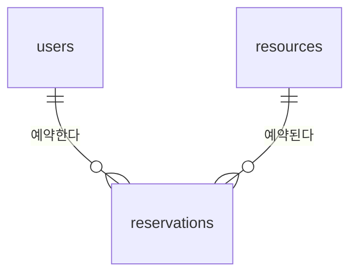

# Reservation API

회의실 같은 공용 자원의 예약을 관리하는 REST API입니다.
같은 시간대에 예약이 겹치지 않도록 하는 **동시성 제어**를 핵심 과제로 다룹니다.

> 🚧 개발 중입니다. 현재는 프로젝트 뼈대와 헬스 체크 API만 있습니다.

- 배포 주소: (배포 후 추가)
- API 문서: 서버 실행 후 `/docs` (Swagger UI)

## 기술 스택

| 구분 | 사용 기술 |
| --- | --- |
| 언어 / 프레임워크 | Python 3.11, FastAPI |
| DB / ORM | MySQL 8.0, SQLAlchemy 2.x, PyMySQL |
| 테스트 / 품질 | pytest, ruff, GitHub Actions |

## 주요 기능 (계획)

- [ ] 회원가입과 로그인 (JWT)
- [ ] 자원(회의실) 등록과 조회
- [ ] 예약 생성, 조회, 취소
- [ ] 같은 시간대 중복 예약 방지 (동시 요청 상황 포함)
- [ ] 배포

## DB 설계

`users`, `resources`, `reservations` 세 테이블로 구성합니다. ERD, 정규화 검토, 인덱스 설계 이유는 [docs/erd.md](docs/erd.md)에 정리했습니다.



## 기술적 고민

**같은 자원의 겹치는 예약을 동시 요청 상황에서도 막는 방법**을 두 가지로 구현하고 비교할 예정입니다.

- 비관적 락: `SELECT ... FOR UPDATE`로 자원 행을 잠근 뒤 겹침 검사
- 시간 칸 테이블 + UNIQUE 제약

자세한 내용은 [docs/erd.md](docs/erd.md#핵심-과제-겹치는-예약-막기)에 있습니다.

## 로컬에서 실행하기

Windows PowerShell 기준입니다.

```powershell
# 1. 가상환경과 의존성
py -3.11 -m venv .venv
.\.venv\Scripts\python.exe -m pip install -r requirements-dev.txt

# 2. DB 준비: scripts/init_db.sql의 비밀번호를 바꾼 뒤 root 계정으로 실행
# 3. 환경 변수: .env.example을 .env로 복사하고 DB_PASSWORD를 채운다
Copy-Item .env.example .env

# 4. 서버 실행
.\.venv\Scripts\python.exe -m uvicorn app.main:app --reload
```

- http://127.0.0.1:8000/health : 서버 상태
- http://127.0.0.1:8000/health/db : DB 연결 상태

## 테스트

```powershell
.\.venv\Scripts\python.exe -m pytest -q
```

## 프로젝트 구조

```
app/
  main.py          FastAPI 앱, 라우터 등록
  core/config.py   환경 변수 설정
  db/session.py    DB 엔진과 세션
  api/             기능별 라우터
tests/             pytest 테스트
scripts/           DB 초기화 SQL
docs/              문제 해결 기록
```

## 문제 해결 기록

개발하면서 겪은 문제와 해결 과정은 [docs/troubleshooting.md](docs/troubleshooting.md)에 정리합니다.
