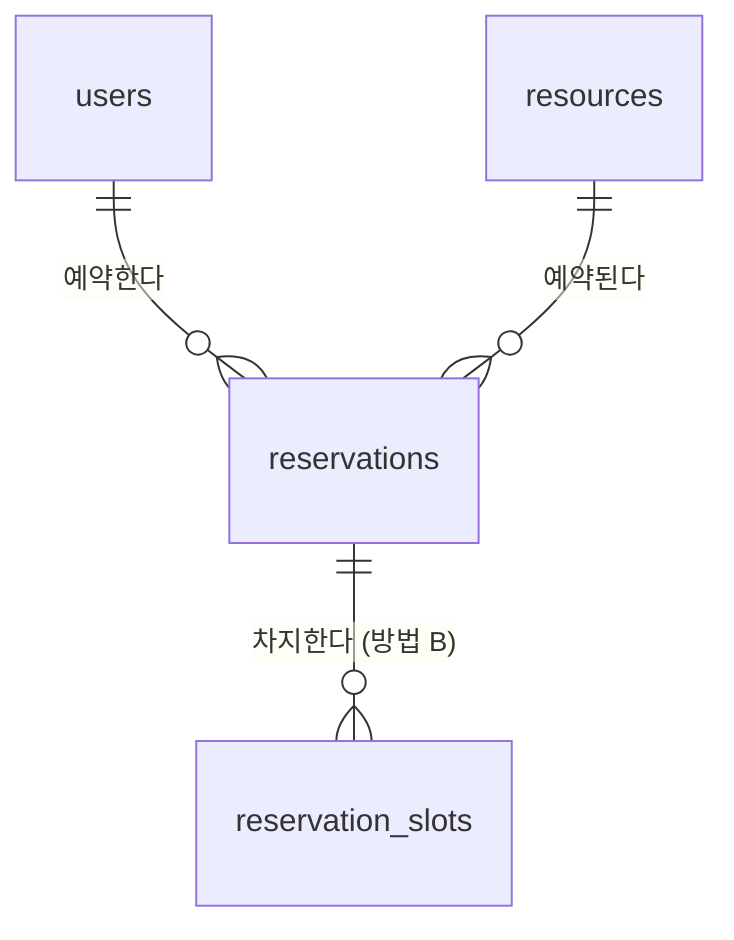

# Reservation API

회의실 같은 공용 자원의 예약을 관리하는 REST API입니다.
같은 시간대에 예약이 겹치지 않도록 하는 **동시성 제어**를 핵심 과제로 다룹니다.

회원가입·로그인, 자원(회의실) 관리, 예약 생성·조회·취소 API를 구현했습니다. 중복 예약을 막는 두 방식을 같은 테스트로 검증하고 부하를 측정해 비교했습니다. 배포는 설정과 절차까지 준비했고, 실제 서버는 띄우지 않았습니다([배포](#배포)).

- API 문서: 서버 실행 후 `/docs` (Swagger UI)

## 기술 스택

| 구분 | 사용 기술 |
| --- | --- |
| 언어 / 프레임워크 | Python 3.11, FastAPI |
| DB / ORM | MySQL 8.0, SQLAlchemy 2.x, PyMySQL |
| 테스트 / 품질 | pytest, ruff, GitHub Actions |

## 주요 기능

- [x] 회원가입과 로그인 (JWT, Argon2id 비밀번호 해시)
- [x] 자원(회의실) 등록, 조회, 수정, 비활성화 (등록과 수정은 관리자만)
- [x] 예약 생성, 조회, 취소
- [x] 같은 시간대 중복 예약 방지 (동시 요청 상황 포함, 비관적 락)
- [x] 다른 방식(시간 칸 + 기본키)으로 구현해 같은 테스트로 검증
- [x] 두 방식의 부하 측정 (처리량, 응답 시간, 데드락)
- [x] 배포 준비 (Docker 이미지, Docker Compose, Render Blueprint, 인증서를 검증하는 DB SSL 접속, CI의 이미지 실행 확인)
- [ ] 실제 배포 (하지 않음, 이유는 [배포](#배포) 참고)

## API

| 메서드 | 경로 | 설명 |
| --- | --- | --- |
| GET | `/health` | 서버 상태 |
| GET | `/health/db` | DB 연결 상태 (실패 시 503) |
| POST | `/auth/signup` | 회원가입 (이메일 중복 시 409) |
| POST | `/auth/login` | 로그인, 액세스 토큰 발급 (OAuth2 form: `username`에 이메일) |
| GET | `/users/me` | 내 정보 🔒 |
| POST | `/resources` | 자원 등록 (이름 중복 시 409) 🔒 관리자 |
| GET | `/resources` | 자원 목록 (`include_inactive`, `limit`, `offset`) |
| GET | `/resources/{id}` | 자원 상세 |
| PATCH | `/resources/{id}` | 자원 수정, `is_active: false`로 비활성화 🔒 관리자 |
| GET | `/resources/{id}/reservations?date=YYYY-MM-DD` | 자원의 하루 일정 (예약된 시간대만, 예약자는 비공개) |
| POST | `/reservations` | 예약 생성 (시간이 겹치거나 비활성 자원이면 409) 🔒 |
| GET | `/reservations/me` | 내 예약 목록 (`include_past`, `include_cancelled`, `limit`, `offset`) 🔒 |
| GET | `/reservations/{id}` | 예약 상세 (남의 예약이면 404, 관리자는 모두 조회) 🔒 |
| POST | `/reservations/{id}/cancel` | 예약 취소 (이미 취소했거나 시작된 예약이면 409) 🔒 |

예약 시각은 시간대를 포함해 보냅니다(예: `2030-01-07T10:00:00+09:00`). 30분 단위(`:00`, `:30`)로 최대 8시간까지 받고, 응답은 한국 시간으로 돌려줍니다.

🔒 표시는 `Authorization: Bearer <토큰>` 헤더가 필요합니다. 서버 실행 후 `/docs`에서 **Authorize** 버튼으로 로그인하면 바로 호출해 볼 수 있습니다.

### 인증 설계

- **비밀번호는 Argon2id로 해시**해 저장합니다. 비밀번호 전용으로 일부러 느리게 만든 알고리즘이라, DB가 유출돼도 무차별 대입이 어렵습니다.
- **로그인 실패 응답을 하나로 통일**했습니다. "없는 이메일"과 "비밀번호 틀림"이 같은 메시지를 돌려줍니다. 없는 이메일일 때도 해시 검증을 한 번 실행해서 응답 시간도 비슷하게 맞췄습니다. 응답 내용이나 시간으로 가입 여부를 알아낼 수 없게 하기 위해서입니다.
- **토큰을 검증할 때 매번 DB에서 사용자를 다시 읽습니다.** 토큰에 담긴 역할을 그대로 믿지 않기 때문에, 탈퇴했거나 권한이 바뀐 사용자의 옛 토큰은 통하지 않습니다.
- **허용할 JWT 알고리즘을 서버에서 고정**했습니다. 토큰 헤더에 적힌 알고리즘을 그대로 믿지 않습니다.
- **관리자는 API로 가입할 수 없습니다.** 관리 명령(`python -m app.cli create-admin`)으로만 만듭니다.

## DB 설계

`users`, `resources`, `reservations` 세 테이블이 기본입니다. 중복 예약을 막는 방법 B용으로 `reservation_slots`가 있습니다. ERD, 정규화 검토, 인덱스 설계 이유는 [docs/erd.md](docs/erd.md)에 정리했습니다.



## 기술적 고민

**같은 자원의 겹치는 예약을 동시 요청 상황에서도 막는 방법**을 두 가지로 구현했습니다. 설정 `RESERVATION_STRATEGY`로 고르고, 같은 테스트를 두 방식에서 모두 돌립니다.

- 방법 A `lock`: `SELECT ... FOR UPDATE`로 자원 행을 잠근 뒤 겹침 검사 (기본값)
- 방법 B `slot`: 예약을 30분 칸으로 쪼개 `reservation_slots`에 넣고, 기본키 `(resource_id, slot_start)` 중복으로 막음

방법 A는 앱 코드(락과 겹침 검사)가 최종 판단을 해서 격리 수준에 영향을 받습니다(아래 문제). 방법 B는 DB 제약이 최종 판단을 해서 격리 수준과 상관이 없고, 겹치지 않는 요청끼리 기다리지 않습니다. 대신 30분 단위로만 예약할 수 있고 칸 데이터가 늘어납니다. 비교표는 [docs/erd.md](docs/erd.md#방법-b-구현-결과-시간-칸--기본키)에 있습니다.

**부하 측정 결과** (32스레드, 960건, `scripts/benchmark_reservations.py`)

| 상황 | 방법 A `lock` | 방법 B `slot` |
| --- | ---: | ---: |
| 같은 자원, 겹치지 않는 요청 | 210건/초 | **269건/초** |
| 같은 자원, 같은 시간대로 몰림 | **460건/초** | 295건/초 |
| 자원 20개에 분산 | 281건/초 | 278건/초 |

- 측정하면서 문제 두 가지를 찾아 고쳤습니다. 하나는 방법 A의 겹침 검사가 과거 예약을 전부 읽어서, 기록 2만 건에서 처리량이 14건/초까지 떨어진 것입니다. 하한 조건을 넣고 DB CHECK 제약을 추가해 219건/초로 회복했습니다. 다른 하나는 방법 B에서 데드락이 난 것입니다. 데드락이 나면 다시 시도하게 해서, 측정에서 오류가 0건이 됐습니다.
- 기본값은 방법 A입니다. 회의실은 인기 시간대에 요청이 몰려 거절이 많은데, 이 경우 방법 A가 빠르고 데드락도 없기 때문입니다. 자세한 분석은 [docs/erd.md](docs/erd.md#부하-측정)에 있습니다.

**락을 걸었는데도 중복 예약이 생긴 문제**를 동시 요청 테스트로 찾았습니다. 같은 시간대 요청 10개를 동시에 보내자 10건이 모두 성공했습니다. 원인은 MySQL 기본 격리 수준(REPEATABLE READ)의 스냅샷이었습니다. 인증 단계에서 사용자를 먼저 읽을 때 스냅샷이 고정되어, 락을 받은 뒤에도 앞 요청이 커밋한 예약을 보지 못했습니다. 격리 수준을 READ COMMITTED로 바꿔 해결했고, 지금은 1건만 성공하고 9건은 409로 거절됩니다.

**취소는 락 없이 조건부 UPDATE 한 문장으로 처리합니다.** `UPDATE ... SET status = 'CANCELLED' WHERE id = ? AND status = 'CONFIRMED'`를 실행하고 바뀐 행 수로 성공 여부를 판단합니다. "읽고 확인한 뒤 객체를 바꿔 저장"하는 방식으로 바꿔 보니, 같은 예약에 대한 동시 취소 요청 10개가 모두 성공했습니다. 조건부 UPDATE에서는 1건만 성공합니다.

자세한 내용은 [docs/erd.md](docs/erd.md#핵심-과제-겹치는-예약-막기)와 [docs/troubleshooting.md](docs/troubleshooting.md)에 있습니다.

## 로컬에서 실행하기

Windows PowerShell 기준입니다.

```powershell
# 1. 가상환경과 의존성
py -3.11 -m venv .venv
.\.venv\Scripts\python.exe -m pip install -r requirements-dev.txt

# 2. DB 준비: scripts/init_db.sql의 비밀번호를 바꾼 뒤 root 계정으로 실행
# 3. 환경 변수: .env.example을 .env로 복사하고 DB_PASSWORD, JWT_SECRET_KEY를 채운다
Copy-Item .env.example .env

# 4. 테이블 생성 (Alembic 마이그레이션)
.\.venv\Scripts\alembic.exe upgrade head

# 5. 관리자 계정 만들기 (비밀번호는 프롬프트로 입력)
.\.venv\Scripts\python.exe -m app.cli create-admin --email admin@example.com --name 관리자

# 6. 서버 실행
.\.venv\Scripts\python.exe -m uvicorn app.main:app --reload
```

- http://127.0.0.1:8000/health : 서버 상태
- http://127.0.0.1:8000/health/db : DB 연결 상태

## 테스트

테스트는 실제 MySQL의 테스트 전용 DB(`reservation_test`)에서 실행합니다. 처음 한 번 `scripts/init_test_db.sql`을 root 계정으로 실행해 두세요.

```powershell
.\.venv\Scripts\python.exe -m pytest -q
```

- 테스트를 시작할 때 마이그레이션을 끝까지 되돌렸다가(`downgrade base`) 다시 적용합니다(`upgrade head`). 마이그레이션 왕복도 함께 검증됩니다.
- 테스트마다 트랜잭션을 열고 끝나면 롤백합니다. 그래서 테스트끼리 데이터가 섞이지 않습니다.
- GitHub Actions에서는 MySQL 8.0 컨테이너를 함께 띄워 같은 테스트를 실행합니다.

## 배포

**현재 상태: 배포 직전까지만 준비했습니다.** 아래 세 가지 방법 중 어느 것으로든 바로 배포할 수 있게 설정 파일과 절차를 갖췄고, 실제 서버는 띄우지 않았습니다.

| 방법 | 파일 | 맞는 곳 |
| --- | --- | --- |
| [Docker 이미지](#방법-1-docker-이미지--관리형-mysql) | `Dockerfile` | Docker 이미지를 받는 플랫폼(Fly.io, Railway, Koyeb, Cloud Run, AWS ECS 등) + 관리형 MySQL |
| [Docker Compose](#방법-2-docker-compose-서버-한-대) | `docker-compose.yml` | 서버 한 대(VPS, EC2 등)에 앱과 MySQL을 함께 |
| [Render Blueprint](#방법-3-render--aiven-mysql) | `render.yaml` | Render 무료 웹 서비스 + Aiven 무료 MySQL |

- 어느 방법이든 **MySQL 8.0**이 필요합니다. 이 앱은 MySQL의 락 동작(`FOR UPDATE`, 중복 키 락)과 오류 번호(1062, 1213, 3819)에 기대기 때문입니다. PostgreSQL이나 MySQL 호환 DB(TiDB 등)로 바꾸면 동시성 검증을 다시 해야 합니다.
- 세 방법 모두 같은 시작 스크립트(`scripts/start.sh`)로 돕니다. 그래서 어디에 배포해도 시작 순서와 옵션이 같습니다.
- 확인한 것: 시작 스크립트는 로컬에서 실행해 봤습니다(마이그레이션 → 서버 → `/health/db` 정상). Docker 이미지는 로컬에 Docker가 없어서, **CI가 커밋마다** 이미지를 빌드하고 MySQL과 함께 띄워 확인합니다(`.github/workflows/ci.yml`의 `container` 작업).

### 환경 변수

| 이름 | 필수 | 설명 |
| --- | :---: | --- |
| `DB_HOST`, `DB_PORT`, `DB_NAME`, `DB_USER`, `DB_PASSWORD` | ✅ | MySQL 접속 정보 |
| `JWT_SECRET_KEY` | ✅ | 토큰 서명 키. 기본값이 없어서, 없으면 시작하지 않습니다. 만들기: `python -c "import secrets; print(secrets.token_urlsafe(48))"` |
| `DB_SSL_CA` | 원격 DB면 ✅ | DB 서버의 CA 인증서 파일 경로. 지정하면 SSL로 접속하고 인증서를 검증합니다 |
| `DB_SSL_VERIFY_IDENTITY` | | 인증서의 호스트 이름 검사 (기본 `true`) |
| `RESERVATION_STRATEGY` | | 중복 예약 방지 방식 `lock`(기본) 또는 `slot` |
| `ACCESS_TOKEN_EXPIRE_MINUTES` | | 토큰 유효 시간 (기본 60분) |
| `PORT` | | 서버 포트 (기본 8000). 대부분의 플랫폼이 알아서 넣어 줍니다 |
| `FORWARDED_ALLOW_IPS` | | `X-Forwarded-*` 헤더를 믿을 프록시 IP (기본 `127.0.0.1`). 플랫폼 프록시 뒤에서는 그 프록시의 IP, 모르면 `*` |
| `RUN_MIGRATIONS` | | 시작할 때 마이그레이션 적용 여부 (기본 `true`) |

### 공통: 시작 스크립트와 관리자 계정

`scripts/start.sh`는 ① `alembic upgrade head`로 마이그레이션을 적용하고 ② uvicorn을 실행합니다.

- **인스턴스가 하나면** 그대로 씁니다.
- **인스턴스를 여러 개 띄우면** `RUN_MIGRATIONS=false`로 두고, 플랫폼의 배포 전 명령(release command, pre-deploy 등)에서 `python -m alembic upgrade head`를 한 번만 실행합니다. 여러 인스턴스가 동시에 시작하면서 마이그레이션이 겹쳐 돌면 안 되는데, Alembic은 이를 막아 주지 않기 때문입니다.
- **헬스 체크**는 DB를 보지 않는 `/health`를 씁니다. DB 상태는 `/health/db`로 따로 봅니다.

관리자 계정은 API로 만들 수 없고 관리 명령으로만 만듭니다. 비밀번호는 프롬프트로 입력합니다.

```powershell
# 서버나 컨테이너 셸에 들어갈 수 있으면 그 안에서
python -m app.cli create-admin --email admin@example.com --name 관리자

# 셸에 들어갈 수 없으면(Render 무료 플랜 등) 내 PC에서 운영 DB에 직접 접속해서.
# 현재 창의 환경 변수가 .env보다 우선합니다.
$env:DB_HOST="<Host>"; $env:DB_PORT="<Port>"; $env:DB_NAME="reservation"
$env:DB_USER="<User>"; $env:DB_PASSWORD="<Password>"; $env:DB_SSL_CA="C:\path\to\ca.pem"
.\.venv\Scripts\python.exe -m app.cli create-admin --email admin@example.com --name 관리자
```

### 방법 1: Docker 이미지 + 관리형 MySQL

```bash
docker build -t reservation-api .
docker run -d -p 8000:8000 --env-file prod.env \
  -v /path/to/ca.pem:/run/secrets/db-ca.pem:ro \
  reservation-api
```

- `prod.env`에 위 환경 변수를 적고 `DB_SSL_CA=/run/secrets/db-ca.pem`으로 둡니다. 이 파일은 저장소에 올리지 않습니다.
- 플랫폼에 배포할 때는 플랫폼이 이 `Dockerfile`로 이미지를 만들게 하거나, 직접 만든 이미지를 레지스트리에 올립니다. 환경 변수는 플랫폼의 비밀 값 설정에 넣고, CA 인증서는 플랫폼의 비밀 파일 기능이나 볼륨으로 넣습니다.
- 관리형 MySQL은 Aiven, AWS RDS, Google Cloud SQL 등 MySQL 8.0이면 됩니다.

### 방법 2: Docker Compose (서버 한 대)

앱과 MySQL을 한 서버에 함께 띄웁니다. MySQL은 내부 네트워크로만 접속하고 포트를 밖에 열지 않으므로 SSL 설정이 필요 없습니다.

```bash
git clone <이 저장소> && cd reservation-api
# 비밀 값은 서버의 .env에만 둡니다 (저장소에 올리지 않음)
cat > .env <<'EOF'
DB_PASSWORD=<MySQL 앱 계정 비밀번호>
JWT_SECRET_KEY=<무작위 값>
EOF
docker compose up -d --build
curl http://localhost:8000/health/db
docker compose exec app python -m app.cli create-admin --email admin@example.com --name 관리자
```

- 데이터는 Docker 볼륨(`db-data`)에 남습니다. 관리형 DB와 달리 **백업은 직접 해야 합니다**(예: `docker compose exec db mysqldump ...`를 주기적으로 실행).
- HTTPS는 앞에 리버스 프록시(Caddy, Nginx 등)를 두고 처리합니다. 이때 `FORWARDED_ALLOW_IPS`를 그 프록시의 IP로 바꿉니다.

### 방법 3: Render + Aiven MySQL

`render.yaml`(Render Blueprint)에 설정이 있습니다. Render의 관리형 DB는 PostgreSQL뿐이라 DB는 Aiven 무료 MySQL에 둡니다.

**실제로 배포하지 않은 이유**: Render 무료 플랜은 **워크스페이스마다 한 달 750시간**을 주고, 그 워크스페이스의 무료 서비스가 모두 이 시간을 나눠 씁니다. 다 쓰면 그 워크스페이스의 무료 서비스가 **전부** 다음 달까지 정지됩니다. 같은 워크스페이스에서 이미 다른 서비스가 한 달 내내 깨어 있어 750시간을 거의 다 쓰므로, 여기에 이 API를 더하면 두 서비스가 함께 멈출 수 있습니다. 배포할 때는 아래 0단계처럼 이 API 전용 워크스페이스를 새로 만듭니다. Render는 무료 Hobby 워크스페이스를 계정당 5개까지 허용하고, 시간은 워크스페이스마다 따로 계산됩니다.

0. **Render에서 이 API용 Hobby 워크스페이스를 새로 만듭니다.** 1~4단계는 모두 이 워크스페이스에서 합니다.
1. **Aiven에서 MySQL 만들기**
   - 무료 플랜으로 MySQL 서비스를 만듭니다. Render 서비스(싱가포르)와 가까운 리전을 고르면 지연이 줄어듭니다.
   - 서비스 화면의 *Databases*에서 `reservation` 데이터베이스를 만듭니다.
   - *Overview*에서 Host, Port, User, Password를 확인하고, **CA certificate**를 내려받습니다.
2. **Render에서 Blueprint로 만들기**
   - *New → Blueprint*에서 이 저장소를 고르면 `render.yaml`을 읽습니다.
   - `DB_HOST`, `DB_PORT`, `DB_NAME`(`reservation`), `DB_USER`, `DB_PASSWORD`를 입력합니다. `JWT_SECRET_KEY`는 Render가 무작위로 만듭니다.
3. **CA 인증서 올리기**
   - 서비스의 *Environment → Secret Files*에 파일 이름 `aiven-ca.pem`으로 CA 인증서 내용을 붙여 넣습니다(`/etc/secrets/aiven-ca.pem`).
   - 2단계에서 바로 시작된 첫 배포는 인증서가 없어서 실패할 수 있습니다. 인증서를 저장하면 다시 배포됩니다.
4. **관리자 계정과 확인**: 무료 플랜은 셸에 들어갈 수 없으므로 [위의 방법](#공통-시작-스크립트와-관리자-계정)대로 내 PC에서 만듭니다. `https://<서비스 이름>.onrender.com/health/db`가 `{"status":"ok","database":"ok"}`이면 DB까지 연결된 것입니다.

Render 설정 메모:

- 무료 플랜은 배포 전 명령(`preDeployCommand`)을 쓸 수 없어서, 시작 스크립트에서 마이그레이션을 적용합니다. 인스턴스가 하나라 겹쳐 돌 일은 없습니다.
- CI가 통과한 커밋만 배포합니다(`autoDeployTrigger: checksPass`).
- Python 버전은 `.python-version`(3.11)으로 고정합니다. Render의 기본값은 3.14라서, 고정하지 않으면 로컬, CI와 다른 버전으로 돕니다.
- 무료 플랜은 15분 동안 요청이 없으면 잠들고, 깨어나는 데 1분쯤 걸립니다. CPU가 0.1개라 로그인(Argon2 해시)이 로컬보다 느릴 수 있습니다.

### 배포 설정에서 고민한 것

- **DB 연결은 SSL과 인증서 검증을 함께 씁니다.** `DB_SSL_CA`를 지정하면 PyMySQL이 서버 인증서와 호스트 이름을 검증합니다. 로컬에서 확인해 보니 PyMySQL은 CA를 지정하지 않아도 서버가 지원하면 암호화는 하지만, 인증서는 검증하지 않았습니다. 그러면 중간에 가짜 서버가 끼어들어도 알 수 없습니다. 반대로 엉뚱한 CA를 지정하자 `CERTIFICATE_VERIFY_FAILED`로 접속이 거부되어, 검증이 실제로 동작하는 것도 확인했습니다.
- **시작 명령을 스크립트 하나로 모았습니다.** Dockerfile과 render.yaml이 같은 `scripts/start.sh`를 실행하므로, 한쪽만 고쳐서 배포 환경마다 동작이 달라지는 일이 없습니다.
- **스크립트는 마지막에 `exec`로 uvicorn을 실행합니다.** 셸이 남아 있으면 플랫폼이 종료할 때 보내는 SIGTERM을 셸이 받고 uvicorn에 전달하지 않습니다. 그러면 처리 중인 요청을 마치지 못하고 강제 종료됩니다.
- **컨테이너는 root가 아닌 전용 사용자(uid 10001)로 돕니다.** 앱에 취약점이 있어도 컨테이너 안에서 할 수 있는 일을 줄이기 위해서입니다. CI가 이것도 확인합니다.
- **이미지에 비밀 정보와 개발 도구를 넣지 않습니다.** `.dockerignore`가 `.env`, 인증서, 테스트, 문서를 빼고, 운영용 `requirements.txt`만 설치합니다. 이미지는 레지스트리에 올라가므로, 안에 든 파일은 누구나 꺼내 볼 수 있다고 생각해야 합니다.
- **의존성을 소스보다 먼저 설치합니다.** Docker는 단계별 결과를 저장해 두므로, `requirements.txt`가 그대로면 소스만 바꿔 다시 빌드할 때 설치 단계를 건너뜁니다.

## 프로젝트 구조

```
app/
  main.py          FastAPI 앱, 라우터 등록
  core/config.py   환경 변수 설정
  db/session.py    DB 엔진과 세션
  db/base.py       ORM Base, 제약 이름 규칙
  models/          ORM 모델 (users, resources, reservations, reservation_slots)
  schemas/         요청과 응답 형식 (Pydantic)
  services/        비즈니스 로직 (HTTP와 무관)
  api/             기능별 라우터
  api/deps.py      로그인 사용자, 관리자 권한 의존성
  core/security.py 비밀번호 해시, JWT 발급과 검증
  core/exceptions.py  서비스 예외를 HTTP 응답으로 변환
  cli.py           관리 명령 (관리자 계정 생성)
migrations/        Alembic 마이그레이션
tests/             pytest 테스트
scripts/           DB와 계정 생성 SQL, 부하 측정, 운영 시작 스크립트(start.sh)
docs/              DB 설계, 문제 해결 기록
Dockerfile         운영 이미지
docker-compose.yml 앱 + MySQL을 서버 한 대에 띄우는 설정
render.yaml        Render 배포 설정 (Blueprint)
```

## 문제 해결 기록

개발하면서 겪은 문제와 해결 과정은 [docs/troubleshooting.md](docs/troubleshooting.md)에 정리합니다.
