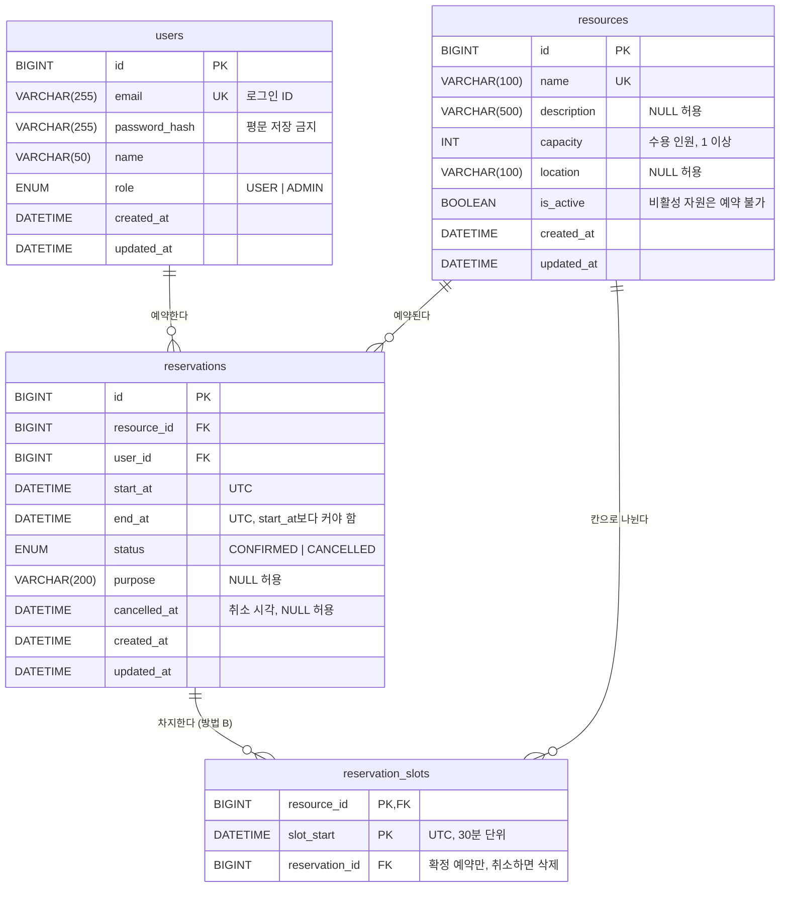

# DB 설계 (ERD)

## 요구사항 정리

설계 전에 "무엇을 저장해야 하는가"를 먼저 정리했다.

1. 회원은 이메일과 비밀번호로 가입하고 로그인한다. 회원은 일반 사용자와 관리자로 나뉜다.
2. 관리자는 예약 대상 자원(회의실 등)을 등록하고 수정한다. 더 이상 쓰지 않는 자원은 비활성화한다.
3. 회원은 자원을 특정 시간대(시작~종료)로 예약하고, 자기 예약을 취소할 수 있다.
4. **같은 자원의 확정된 예약끼리는 시간이 겹치면 안 된다.** 동시에 요청이 들어와도 지켜져야 한다.
5. 취소된 예약도 기록으로 남긴다. (언제 누가 취소했는지 확인할 수 있어야 함)

## ERD



- `reservation_slots`는 방법 B(시간 칸 + UNIQUE)에서만 쓴다. 아래 [방법 B 구현 결과](#방법-b-구현-결과-시간-칸--기본키)를 참고한다.

- 회원 1명은 예약을 0개 이상 가진다. 자원 1개도 예약을 0개 이상 가진다.
- `reservations`가 `users`와 `resources`를 잇는 테이블이다. 그런데 단순히 둘을 연결만 하는 테이블이 아니라 시간대와 상태라는 자기 속성을 가진 독립된 개체다. 그래서 `(user_id, resource_id)`를 묶은 복합키 대신 별도의 `id`를 기본키로 둔다. 같은 회원이 같은 자원을 여러 번 예약할 수 있기 때문이다.

## 정규화 관점에서 확인한 것

- **1정규형**: 모든 컬럼이 값 하나만 가진다. 예를 들어 "참석자 목록"을 한 칸에 쉼표로 넣지 않는다. 참석자 기능이 필요해지면 `reservation_attendees` 테이블로 분리한다.
- **2정규형**: 모든 테이블의 기본키가 단일 컬럼(`id`)이다. 그래서 키의 일부에만 의존하는 컬럼(부분 함수 종속)이 생길 수 없다.
- **3정규형**: `reservations`에 회원 이름이나 자원 이름을 복사해 두지 않는다. 이름은 `user_id`, `resource_id`를 통해서만 얻는다. 이름을 복사해 두면 회원이 이름을 바꿀 때 예약 행까지 모두 고쳐야 하는 갱신 이상이 생긴다.
- **일부러 반정규화하지 않은 것**: "자원별 예약 수" 같은 집계 컬럼은 두지 않는다. 필요할 때 `COUNT`로 계산한다. 성능 문제가 실제로 측정되면 그때 다시 검토한다.

## 설계 결정과 이유

### 1. 시간은 `DATETIME`에 UTC로 저장

- `TIMESTAMP`는 2038년까지만 표현할 수 있다. 또 DB 세션의 시간대 설정에 따라 값이 자동으로 변환된다.
- `DATETIME`은 저장한 값을 그대로 돌려준다. 그래서 "항상 UTC로 저장하고, API에서 응답할 때 한국 시간으로 바꾼다"는 규칙을 앱에서 일관되게 지킨다.

### 2. 예약은 지우지 않고 `status`로 취소 표시 (소프트 삭제)

- 행을 `DELETE`하면 "누가 언제 예약했다가 취소했는지"가 사라진다.
- 겹침 검사는 `status = 'CONFIRMED'`인 예약만 대상으로 한다. 그래서 취소된 시간대에는 다시 예약할 수 있다.

### 3. `status`, `role`은 별도 테이블 대신 `ENUM`

- 값이 2개로 고정되어 있고, 값마다 붙는 추가 정보도 없다. 그래서 코드 테이블을 따로 만들고 조인하는 비용이 더 크다고 판단했다.
- 대신 값을 추가할 때는 `ALTER TABLE`이 필요하다. 상태가 자주 늘어나면 코드 테이블로 바꾸는 것을 검토한다.

### 4. DB 제약으로 막을 수 있는 것은 DB에서 막는다

- `CHECK (start_at < end_at)`: 끝나는 시각이 시작 시각보다 빠른 예약을 막는다. MySQL은 8.0.16부터 CHECK 제약을 실제로 검사한다.
- `CHECK (capacity >= 1)`
- `UNIQUE (email)`, `UNIQUE (name)`: 앱에서 먼저 확인하더라도, 동시에 요청이 들어올 수 있으므로 최종 보장은 DB가 한다.
- 외래키는 `ON DELETE RESTRICT`로 둔다. 예약 기록이 있는 회원이나 자원은 지우지 못하게 하고, 자원은 `is_active = FALSE`로 비활성화한다.

### 5. 인덱스: 자주 실행될 쿼리를 기준으로 정함

| 인덱스 | 쓰이는 쿼리 |
| --- | --- |
| `(resource_id, start_at)` | 이 자원에서 이 시간대와 겹치는 예약이 있는가? 이 자원의 특정 날짜 예약 목록 |
| `(user_id, start_at)` | 내 예약 목록 (시간순) |

- `resource_id`가 앞에 오는 이유: 겹침 검사는 항상 "특정 자원"으로 먼저 좁힌 다음 시간 범위를 본다. 복합 인덱스는 왼쪽 컬럼부터 사용된다.
- 외래키 컬럼에는 인덱스가 필요하다. 위 두 인덱스가 각각 `resource_id`, `user_id`로 시작하므로 따로 만들지 않아도 된다.
- 실제 데이터를 넣은 뒤 `EXPLAIN`으로 인덱스가 쓰이는지 확인할 예정이다.

## 핵심 과제: 겹치는 예약 막기

두 예약 A, B가 겹치는 조건은 다음과 같다.

```sql
A.start_at < B.end_at AND B.start_at < A.end_at
```

끝나는 시각과 다음 예약의 시작 시각이 같은 경우(10:00~11:00 다음에 11:00~12:00)는 겹치지 않는 것으로 본다.

문제는 **"겹치는 예약이 없는지 확인한 다음 INSERT"를 그냥 하면 동시 요청에서 깨진다는 것**이다. 두 요청이 동시에 확인하면 둘 다 "없음"을 보고, 둘 다 INSERT한다. 이 문제를 막는 방법 두 가지를 모두 구현했고, 설정 `RESERVATION_STRATEGY=lock|slot`으로 고른다(기본값 `lock`).

| | 방법 A: 비관적 락 | 방법 B: 시간 칸 테이블 + UNIQUE |
| --- | --- | --- |
| 방식 | 트랜잭션 안에서 `SELECT ... FROM resources WHERE id = ? FOR UPDATE`로 자원 행을 잠근 뒤 겹침을 검사하고 INSERT한다 | 예약을 30분 칸으로 쪼개 `reservation_slots(resource_id, slot_start)`에 넣고 UNIQUE 제약으로 막는다 |
| 장점 | 테이블 구조가 단순하다. 시간 단위의 제약이 없다 | DB 제약이 최종 보장을 한다. 락을 기다리지 않는다 |
| 단점 | 같은 자원에 대한 예약 요청이 한 줄로 서서 처리된다 | 30분 단위로만 예약할 수 있다. 칸 데이터가 늘어난다 |

- 방법 A를 먼저 구현하고 동시 요청 테스트로 검증한 뒤, 방법 B를 구현했다.
- 두 방식을 공정하게 비교하려고 **같은 API, 같은 입력 규칙(30분 단위), 같은 테스트**를 쓴다. 예약 테스트는 `reservation_strategy` 픽스처로 두 방식에서 한 번씩 실행된다(`tests/conftest.py`).
- 겹치는 예약 행이 아니라 부모인 자원 행을 잠그는 이유가 있다. `reservations`에서 범위를 `FOR UPDATE`로 잠그면 InnoDB의 갭 락(gap lock)이 걸린다. 갭 락은 서로 막지 않기 때문에 두 트랜잭션이 같은 범위의 갭 락을 동시에 잡은 뒤 둘 다 INSERT하려고 하면 데드락이 생길 수 있다. 자원 행 하나를 잠그면 이 문제 없이 "자원별로 한 번에 하나씩"이 보장된다.

### 방법 A 구현 결과와 격리 수준 (READ COMMITTED)

`app/services/reservation_service.py`의 `_create_with_lock`이 방법 A를 구현한다.

```
1. SELECT ... FROM resources WHERE id = ? FOR UPDATE   -- 같은 자원 요청은 여기서 대기
2. SELECT id FROM reservations                          -- 겹침 검사 (잠금 없는 일반 읽기)
   WHERE resource_id = ? AND status = 'CONFIRMED'
     AND start_at < :end AND end_at > :start LIMIT 1
3. INSERT INTO reservations ...
4. COMMIT                                               -- 락 해제
```

**격리 수준은 MySQL 기본값(REPEATABLE READ)이 아니라 READ COMMITTED를 쓴다.** 동시 요청 테스트로 직접 확인한 문제 때문이다. (자세한 과정: [troubleshooting.md](troubleshooting.md))

| | REPEATABLE READ (기본값) | READ COMMITTED (선택) |
| --- | --- | --- |
| 일반 SELECT가 보는 데이터 | 트랜잭션의 첫 일반 SELECT 시점의 스냅샷 | 각 문장을 실행하는 시점의 최신 커밋 |
| 이 설계에서 결과 | 인증 단계에서 사용자를 먼저 읽어 스냅샷이 고정된다. 락을 받은 뒤에도 앞 요청의 예약이 안 보여 **중복 예약이 생겼다** | 락을 받은 뒤의 겹침 검사가 앞 요청의 예약을 본다 |
| 잃는 것 | | 한 트랜잭션 안에서 같은 SELECT를 두 번 하면 결과가 다를 수 있다(반복 불가능한 읽기). 이 앱의 트랜잭션은 요청 하나 단위로 짧고, 같은 값을 다시 읽어 비교하는 로직이 없어서 문제가 되지 않는다 |

- 덤으로, READ COMMITTED에서는 잠금 읽기나 UPDATE를 하더라도 검색 범위에 갭 락을 걸지 않는다(외래키와 중복 키 검사는 예외). 앞으로 취소 같은 UPDATE를 추가할 때 갭 락 데드락 걱정이 줄어든다.
- 동시성 검증: `tests/test_reservation_concurrency.py`가 같은 시간대 요청 10개를 동시에 보내 1건만 성공하는지, 겹치지 않는 요청 10개는 모두 성공하는지 확인한다.

### 방법 B 구현 결과 (시간 칸 + 기본키)

`create_reservation`이 `RESERVATION_STRATEGY=slot`일 때 `_create_with_slots`로 동작한다.

```
1. SELECT ... FROM resources WHERE id = ?            -- 존재, 활성 여부만 확인 (락 없음)
2. INSERT INTO reservations ...                       -- id를 얻기 위해 flush
3. INSERT INTO reservation_slots VALUES               -- 예약이 차지하는 칸 전부, 시간순
     (자원, 10:00, 예약), (자원, 10:30, 예약), ...
4. COMMIT  -- 3에서 중복 키 오류(1062)가 나면 1~3을 통째로 롤백하고 409
```

- **겹침 검사 SELECT가 없다.** "같은 자원의 같은 칸은 한 행만"이라는 기본키 `(resource_id, slot_start)`가 최종 판단을 한다. 그래서 격리 수준이나 스냅샷과 상관없이 맞다. 방법 A에서 겪은 REPEATABLE READ 문제가 이 방식에는 처음부터 없다.
- UNIQUE 제약을 따로 두지 않고 기본키로 만들었다. InnoDB는 기본키 순서로 행을 저장하므로, 같은 자원의 칸들이 시간순으로 붙어 저장된다.
- 칸은 시간순으로 넣는다. 모든 트랜잭션이 같은 순서로 행 락을 잡게 해서, 서로가 가진 칸을 기다리는 순환 대기(데드락)를 줄인다.
- 취소하면 같은 트랜잭션에서 그 예약의 칸을 지운다(`ix_reservation_slots_reservation_id` 사용). 예약 행은 기록으로 남고 칸만 비워져, 그 시간대를 다시 예약할 수 있다.
- 자원 활성 여부는 락 없이 읽는다. 그래서 관리자가 자원을 비활성화하는 순간과 예약이 겹치면 예약이 하나 만들어질 수 있다. 방법 A는 자원 행을 잠그므로 이 경우도 막는다. 비활성화는 드문 관리 작업이라 허용했다.

| | 방법 A: 자원 행 락 | 방법 B: 시간 칸 + 기본키 |
| --- | --- | --- |
| 최종 보장 | 앱 코드 (락 + 겹침 검사) | DB 제약 (기본키 중복) |
| 격리 수준 영향 | 있음. REPEATABLE READ에서 중복 예약이 생겼다 | 없음 |
| 같은 자원 동시 요청 | 겹치지 않아도 한 줄로 서서 처리 | 겹치는 칸이 없으면 서로 기다리지 않음 |
| 시간 단위 | 제약 없음 (이 프로젝트는 비교를 위해 30분으로 맞춤) | 칸 크기(30분)로 고정 |
| 저장 공간 | 예약 1행 | 예약 1행 + 칸 N행 (8시간 예약이면 16행) |
| 실수할 여지 | 락을 빼먹거나 격리 수준을 바꾸면 조용히 깨진다 | 칸 생성과 삭제를 빼먹으면 깨진다 (상태 변경과 같은 트랜잭션에 묶음) |
| 운영 중 전환 | | lock → slot으로 바꾸려면 기존 확정 예약의 칸을 먼저 채워 넣어야 한다 |

- 검증: 같은 시간대 10건 동시 요청에서 1건만 성공, 겹치지 않는 10건은 모두 성공, 바로 옆과 칸 하나씩 겹치는 사슬 모양 10건에서 확정 예약끼리 겹치지 않음. 두 방식 모두 통과했고, 동시성 테스트를 15번 반복해도 같았다.
- 아직 확인하지 않은 것: 동시 요청이 많을 때의 처리량과 응답 시간 차이, 그리고 방법 B에서 데드락(MySQL 1213)이 실제로 생기는지. 중복 키 오류가 난 트랜잭션이 롤백되면서 그 칸을 기다리던 여러 트랜잭션이 동시에 깨어나면 데드락이 날 수 있다고 알려져 있다. 15번 반복에서는 나오지 않았다. 지금 코드는 1213을 409로 바꾸지 않으므로, 생기면 500이 된다. 부하 테스트로 측정할 예정이다.

### 취소: 락 대신 조건부 UPDATE

```sql
UPDATE reservations SET status = 'CANCELLED', cancelled_at = CURRENT_TIMESTAMP
WHERE id = ? AND status = 'CONFIRMED'
```

- 바뀐 행 수가 1이면 성공이고, 0이면 그 사이에 다른 요청이 먼저 취소한 것이다(409).
- UPDATE는 행을 잠그고 그 행의 최신 값으로 WHERE 조건을 다시 확인한다. 그래서 동시에 들어온 취소 요청 중 하나만 1행을 바꾼다. 따로 `FOR UPDATE`를 걸 필요가 없다.
- 예약 생성처럼 자원 행을 잠그지 않는 이유: 취소는 "한 행의 상태가 바뀌는 것"이라 그 행만 지키면 된다. 생성은 "아직 없는 행"끼리 부딪히는 문제라 지킬 행이 없어서 부모(자원) 행을 잠갔다.
- 취소와 생성이 동시에 일어나면, 생성 쪽이 "아직 취소되지 않은 예약"을 보고 409를 줄 수 있다. 다시 시도하면 성공한다. 반대로 중복 예약이 생기는 경우는 없으므로 허용한다.
- `tests/test_reservation_concurrency.py`가 같은 예약에 대한 취소 요청 10개를 동시에 보내 1건만 성공하는지 확인한다. "읽고 → 객체 값 바꿔 저장"하는 방식으로 바꾸면 10건이 모두 성공해 테스트가 실패하는 것도 확인했다.

### 조회 규칙

- 예약 상세와 취소는 본인과 관리자만 할 수 있다. 남의 예약이면 403이 아니라 404를 돌려준다. 403이면 그 번호의 예약이 있다는 사실이 드러나기 때문이다.
- 자원의 하루 일정(`GET /resources/{id}/reservations?date=`)은 로그인 없이 볼 수 있다. 빈 시간을 확인하는 용도라 시간대만 보여 주고, 예약자와 목적은 보여 주지 않는다.
- "그날"은 한국 날짜 기준이다(UTC로 전날 15:00 ~ 당일 15:00). 그날 시작한 예약이 아니라 그날과 **겹치는** 예약을 돌려준다. 그래야 자정을 넘는 예약이 일정표에서 빠지지 않는다.

### 예약 입력 규칙

- 시각은 시간대를 포함해서 받는다(`+09:00`, `Z` 등). 시간대 없는 값은 한국 시간인지 UTC인지 알 수 없으므로 422로 거절한다. 응답은 한국 시간(`+09:00`)으로 돌려준다.
- 30분 단위(`:00`, `:30`)만 받는다. 방법 B가 30분 칸으로만 막을 수 있어서, 두 방식을 같은 입력으로 비교하려고 방법 A에도 같은 규칙을 둔다.
  - 경계는 UTC로 바꾼 뒤 검사한다. 칸이 UTC 기준으로 나뉘기 때문이다. 예를 들어 `+05:45`의 10:00은 UTC 04:15라 거절하고, 10:15는 UTC 04:30이라 받는다.
  - 초와 소수 초도 0이어야 한다. 컬럼이 `DATETIME`(소수 초 없음)이라 MySQL이 소수 초를 반올림해 저장하기 때문이다. 앱이 검사한 값과 저장된 값이 달라지는 것을 막는다.
- 한 번에 최대 8시간까지 예약할 수 있다. 상한이 없으면 예약 하나가 자원을 독점할 수 있고, 방법 B에서는 1년짜리 예약 하나에 칸이 17,520개 생긴다.
- 이미 지난 시각은 예약할 수 없다. 비활성 자원은 예약할 수 없다(409).

## 목표 스키마 (DDL)

아래 DDL은 설계를 확인하기 위한 것이다. 실제 테이블은 SQLAlchemy 모델(`app/models/`)과 Alembic 마이그레이션(`migrations/versions/`)으로 만든다.

마이그레이션을 적용한 뒤 `SHOW CREATE TABLE`로 비교해 보니 컬럼, 기본값, 제약, 인덱스가 모두 아래와 같았다. 외래키 이름은 이름 규칙(`app/db/base.py`)에 따라 `fk_테이블_컬럼_참조테이블` 형식으로 정해진다.

- 외래키를 만들 때 MySQL은 외래키 컬럼에 인덱스가 없으면 인덱스를 자동으로 만든다. 그런데 같은 컬럼으로 시작하는 복합 인덱스가 생기면, 자동으로 만든 인덱스는 지워진다. 그래서 결과 테이블에는 쓸데없는 중복 인덱스가 없다.

```sql
CREATE TABLE users (
    id            BIGINT       NOT NULL AUTO_INCREMENT,
    email         VARCHAR(255) NOT NULL,
    password_hash VARCHAR(255) NOT NULL,
    name          VARCHAR(50)  NOT NULL,
    role          ENUM('USER', 'ADMIN') NOT NULL DEFAULT 'USER',
    created_at    DATETIME     NOT NULL DEFAULT CURRENT_TIMESTAMP,
    updated_at    DATETIME     NOT NULL DEFAULT CURRENT_TIMESTAMP ON UPDATE CURRENT_TIMESTAMP,
    PRIMARY KEY (id),
    UNIQUE KEY uq_users_email (email)
) ENGINE = InnoDB;

CREATE TABLE resources (
    id          BIGINT       NOT NULL AUTO_INCREMENT,
    name        VARCHAR(100) NOT NULL,
    description VARCHAR(500) NULL,
    capacity    INT          NOT NULL,
    location    VARCHAR(100) NULL,
    is_active   BOOLEAN      NOT NULL DEFAULT TRUE,
    created_at  DATETIME     NOT NULL DEFAULT CURRENT_TIMESTAMP,
    updated_at  DATETIME     NOT NULL DEFAULT CURRENT_TIMESTAMP ON UPDATE CURRENT_TIMESTAMP,
    PRIMARY KEY (id),
    UNIQUE KEY uq_resources_name (name),
    CONSTRAINT ck_resources_capacity CHECK (capacity >= 1)
) ENGINE = InnoDB;

CREATE TABLE reservations (
    id           BIGINT       NOT NULL AUTO_INCREMENT,
    resource_id  BIGINT       NOT NULL,
    user_id      BIGINT       NOT NULL,
    start_at     DATETIME     NOT NULL,
    end_at       DATETIME     NOT NULL,
    status       ENUM('CONFIRMED', 'CANCELLED') NOT NULL DEFAULT 'CONFIRMED',
    purpose      VARCHAR(200) NULL,
    cancelled_at DATETIME     NULL,
    created_at   DATETIME     NOT NULL DEFAULT CURRENT_TIMESTAMP,
    updated_at   DATETIME     NOT NULL DEFAULT CURRENT_TIMESTAMP ON UPDATE CURRENT_TIMESTAMP,
    PRIMARY KEY (id),
    KEY ix_reservations_resource_start (resource_id, start_at),
    KEY ix_reservations_user_start (user_id, start_at),
    CONSTRAINT fk_reservations_resource_id_resources FOREIGN KEY (resource_id)
        REFERENCES resources (id) ON DELETE RESTRICT,
    CONSTRAINT fk_reservations_user_id_users FOREIGN KEY (user_id)
        REFERENCES users (id) ON DELETE RESTRICT,
    CONSTRAINT ck_reservations_time CHECK (start_at < end_at)
) ENGINE = InnoDB;

-- 방법 B(시간 칸 + 기본키)용
CREATE TABLE reservation_slots (
    resource_id    BIGINT   NOT NULL,
    slot_start     DATETIME NOT NULL,
    reservation_id BIGINT   NOT NULL,
    PRIMARY KEY (resource_id, slot_start),
    KEY ix_reservation_slots_reservation_id (reservation_id),
    CONSTRAINT fk_reservation_slots_reservation_id_reservations FOREIGN KEY (reservation_id)
        REFERENCES reservations (id) ON DELETE CASCADE,
    CONSTRAINT fk_reservation_slots_resource_id_resources FOREIGN KEY (resource_id)
        REFERENCES resources (id) ON DELETE RESTRICT
) ENGINE = InnoDB;
```

## 앞으로 확장할 때 고려할 것 (지금은 만들지 않음)

- 자원별 운영 시간 (예: 평일 09:00~18:00만 예약 가능): `resource_hours` 테이블
- 참석자: `reservation_attendees (reservation_id, user_id)`
- 예약 변경 이력: `reservation_histories`
